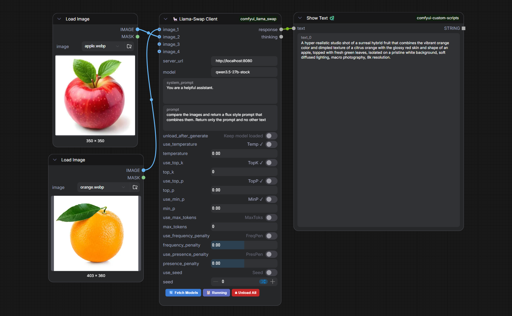

# 🦙 ComfyUI Llama-Swap Client

> A native ComfyUI node for **[llama-swap](https://github.com/mostlygeek/llama-swap)** — hot-swap any llama.cpp model without leaving your workflow.



---

## ✨ Features

| | |
|---|---|
| 🔄 **Live model picker** | Fetches `/v1/models` from your running server and shows a floating dropdown — click to set |
| 🎲 **Seed control** | Uses ComfyUI's native `control after generate` (`fixed` / `increment` / `decrement` / `randomize`) — the seed shown on the node maps deterministically to the one sent to llama-swap, so a run can be reproduced exactly |
| 🖼️ **Vision support** | Connect any ComfyUI `IMAGE` node; the first frame is base64-encoded and sent as `image_url` |
| 🧠 **Thinking extraction** | `<think>` / `<thinking>` blocks are **stripped** from `response` and surfaced in a separate `thinking` output |
| ⏏️ **Auto-unload toggle** | Calls `/unload` automatically after every generation — great for VRAM-constrained setups |
| 📋 **Running button** | Shows which model is currently warm in GPU memory via a toast notification |
| 🔴 **Unload All button** | Manually frees VRAM from inside ComfyUI without touching the terminal |

---

## 🗂️ Nodes

### 🦙 Llama-Swap Client
The main inference node.

| Input | Type | Description |
|---|---|---|
| `server_url` | STRING | llama-swap base URL (default `http://localhost:8080`) |
| `model` | STRING | Model name — populated via **🔄 Fetch Models** |
| `system_prompt` | STRING (multiline) | System role message |
| `prompt` | STRING (multiline) | User message / question |
| `unload_after_generate` | BOOLEAN | Auto-call `/unload` after every run |
| `seed` | INT | Sampling seed (default `0`). `0` = seed left out of the request, llama-swap picks one. Any other value reproduces the same output (sent as `seed % 2^32`, llama.cpp's seed range). Comes with ComfyUI's native **control after generate** widget (`fixed` / `increment` / `decrement` / `randomize`), applied by the frontend |
| `thinking` | COMBO | `auto` / `on` / `off` (default `auto`). `auto` leaves thinking to the model/template. `on` / `off` send `chat_template_kwargs.enable_thinking` to ask the template to enable or skip thinking. Only templates that read `enable_thinking` (e.g. Qwen3) respond to it |
| `image` *(optional)* | IMAGE | Vision input — first frame sent as JPEG base64 |

| Output | Description |
|---|---|
| `response` | Clean human-readable text — **`<think>` blocks removed** |
| `thinking` | Extracted reasoning chain (empty string if the model produced none) |

---

### 🦙 Llama-Swap Model Selector
A standalone picker that outputs `model_name` as a STRING.  
Useful to share the same model choice across multiple inference nodes.

---

## ⚡ Installation

```bash
cd ComfyUI/custom_nodes
git clone https://github.com/yourname/comfyui_llama_swap
```

> **Dependencies:** `requests` and `pillow` — both already present in any standard ComfyUI environment.

Restart ComfyUI after cloning.

---

## 🚀 Quick Start

1. Add a **🦙 Llama-Swap Client** node
2. Set `server_url` to your llama-swap address
3. Click **🔄 Fetch Models** → select a model from the dropdown
4. Connect a **Preview Text** node to `response`
5. *(Optional)* Connect a second **Preview Text** node to `thinking` to debug reasoning chains
6. Hit **Run** 🎉

---

## 🧠 Thinking Output

Models like **DeepSeek-R1**, **QwQ**, **Qwen3** and other reasoning models wrap their chain-of-thought in `<think>` tags.  
This node automatically separates them:

```
response  →  clean answer, ready to use downstream
thinking  →  full reasoning trace for inspection / debugging
```

Both `<think>` and `<thinking>` variants are handled.

---

## 🎲 Reproducing a Generation

The seed value on the node is sent in the OpenAI-compatible `seed` field, folded to llama.cpp's
32-bit seed range (`seed % 2^32`) — the same node value always maps to the same sent seed:

```json
{"model": "qwen3.6-35b-uncensored-nothink", "messages": [{"role": "user", "content": "..."}], "seed": 1234, "stream": false}
```

The seed's **control after generate** widget is ComfyUI's own, so the frontend changes the value
between runs and the backend just sends what it receives. To re-run the exact same completion,
set it to **`fixed`** and keep the seed value (or reload the workflow/image metadata of a past
run). `increment` and `decrement` step the seed per run, while `randomize` picks a fresh seed
each run.

> Note: reproducibility also depends on the model, its quantization and the sampling
> parameters being identical, since the seed alone does not pin those down.

---

## 🔌 Backend Routes

Three lightweight proxy routes are registered on ComfyUI's `PromptServer` at startup to avoid CORS issues:

| Route | Proxies to |
|---|---|
| `GET /llama_swap/models` | `GET {url}/v1/models` |
| `GET /llama_swap/running` | `GET {url}/running` |
| `GET /llama_swap/unload` | `GET {url}/unload` |

---

## 📄 License

MIT
